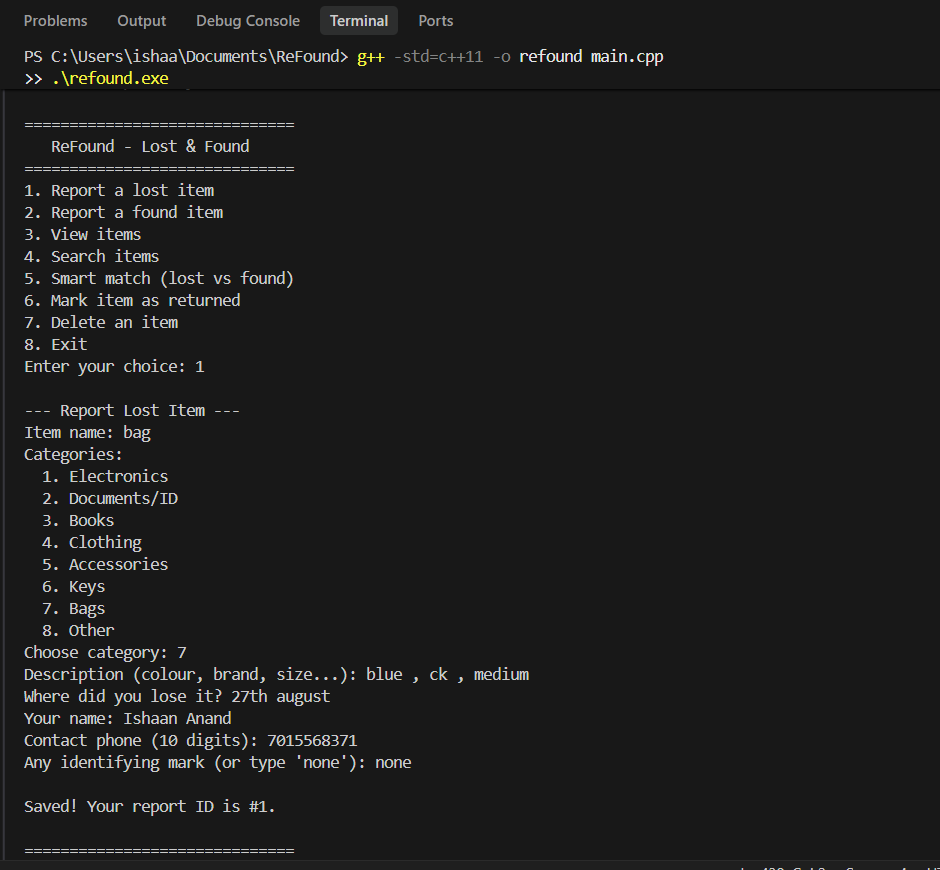
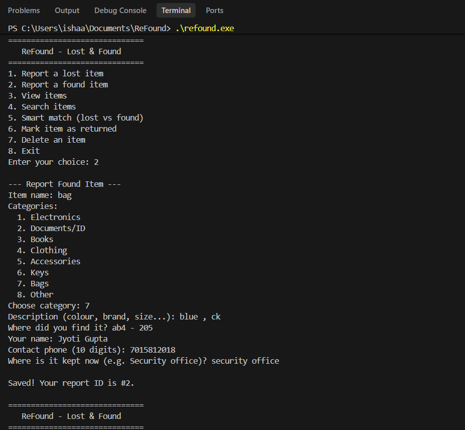
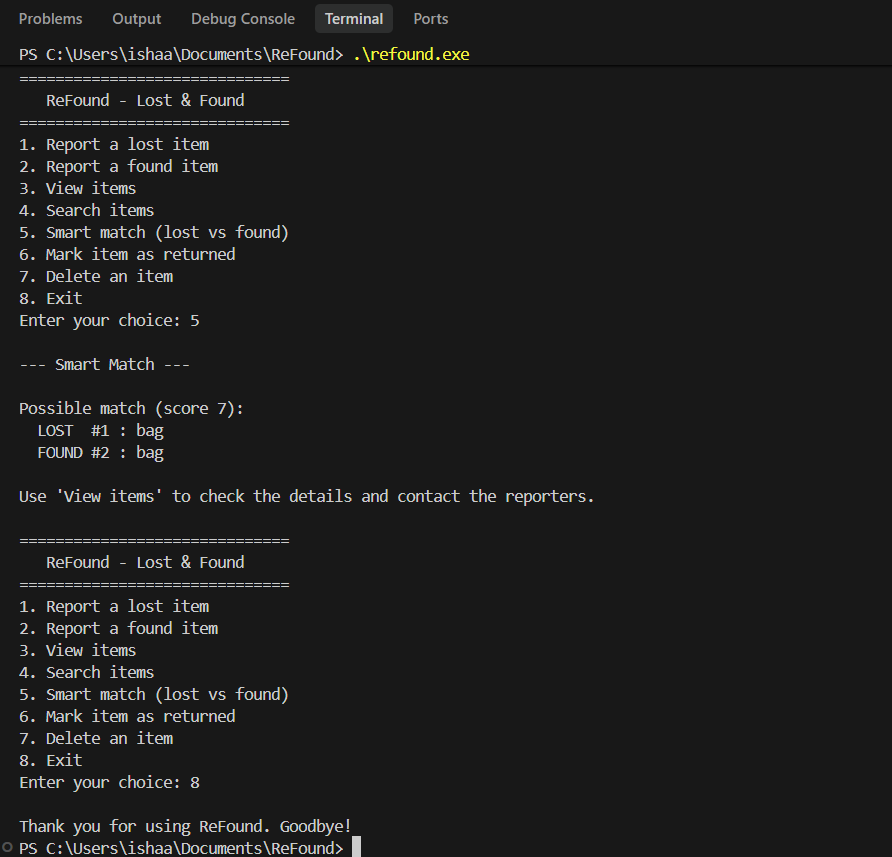

# ReFound - Lost & Found Management System

A console-based Lost & Found system written in C++17. Users can report lost and
found items, search them, and let the program suggest possible matches between
lost and found reports. All data is saved to a file, so it persists between runs.

## Features
- Report lost items and found items (with category, location, contact details)
- View all items, only lost, only found, or only unclaimed ones
- Keyword search across name, category, description and location
- Smart Match: compares lost and found reports and lists likely matches
- Mark an item as returned, or delete a report
- Automatic saving and loading from `items.txt`
- Input validation (empty fields, 10-digit phone, menu ranges)
-    ## Screenshots

   ### Report a lost item
   

   ### Report a found item
   

   ### Smart Match
   

## Concepts used
- Classes and objects, constructors and destructors, const member functions
- Inheritance: abstract base class `Item`, derived classes `LostItem` and `FoundItem`
- Pure virtual functions, virtual functions, runtime polymorphism, virtual destructor
- Static data members and static member functions
- Friend function and operator overloading (`operator<<`)
- Dynamic memory allocation (`new` / `delete`) and pointers to objects
- STL `vector` and `set`, file handling with `ifstream` / `ofstream`, exception handling

## How to run
Requires a C++17 compiler (g++ / MinGW).

```
g++ -std=c++17 -o refound main.cpp
./refound          # on Windows: refound.exe
```

## Project structure
```
ReFound/
  main.cpp     # complete source code
  README.md
  .gitignore
```

## Team ReFound
- Ishaan Anand
- Jyoti Gupta
